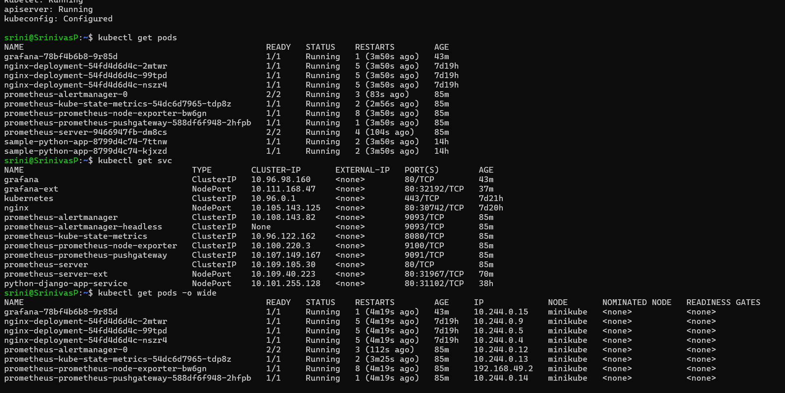
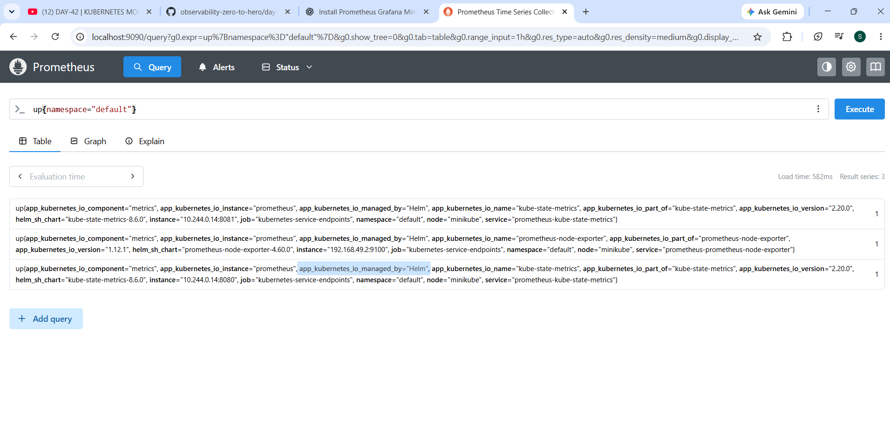
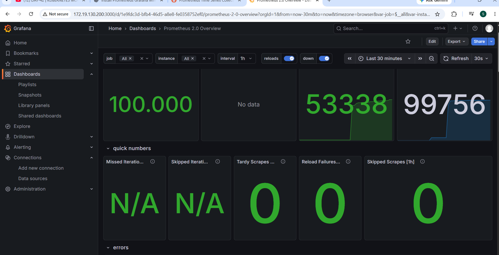
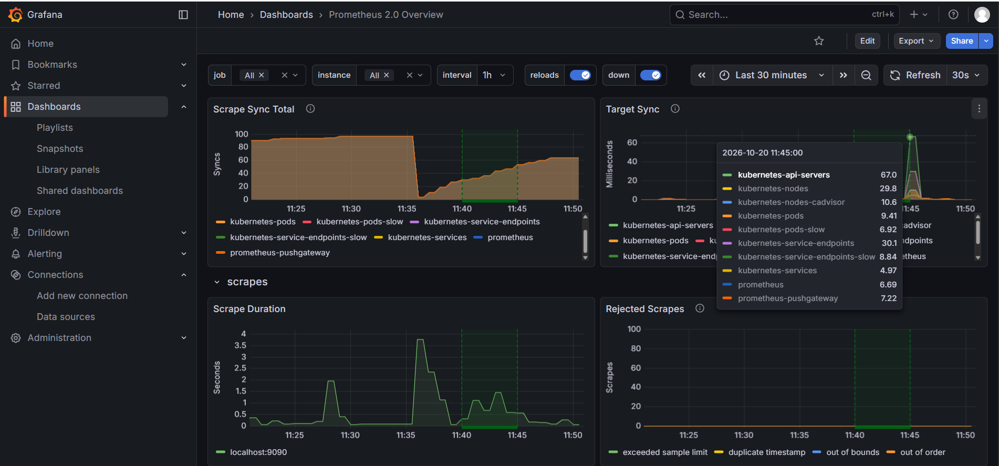

# Kubernetes Monitoring with Prometheus and Grafana

A hands-on monitoring project using **Prometheus** to collect and query metrics, **kube-state-metrics** to expose Kubernetes object-state metrics, and **Grafana** to visualize monitoring data. The environment was run locally on Minikube in Ubuntu/WSL.

## Project goals

- Deploy and verify Prometheus and Grafana in Kubernetes.
- Inspect Kubernetes workload and service status.
- Query metrics in Prometheus.
- Visualize collected metrics in Grafana dashboards.
- Document installation, access, verification, and common troubleshooting steps.

## Architecture

```text
Kubernetes / Minikube
  ├── Application and cluster workloads
  ├── kube-state-metrics ──┐
  ├── node-exporter        ├──> Prometheus ──> Grafana dashboards
  └── other configured targets ┘
```

The metrics visible in Prometheus depend on the configured scrape targets and available exporters.

## Components observed in the working environment

| Component | Kubernetes resource name observed | Port |
|---|---|---:|
| Prometheus UI | `prometheus-server` | Service port 80 |
| Grafana UI | `grafana` | Service port 80 |
| kube-state-metrics | `prometheus-kube-state-metrics` | 8080 |
| node-exporter | `prometheus-prometheus-node-exporter` | 9100 |

Your existing cluster also showed `prometheus-alertmanager` and `prometheus-prometheus-pushgateway` Services. Exact names can differ depending on Helm release names and chart values.

## Repository contents

```text
kubernetes-prometheus-grafana-monitoring/
├── README.md
├── docs/
│   ├── installation.md
│   ├── monitoring-queries.md
│   └── troubleshooting.md
└── images/
    ├── grafana-dashboard-metrics.png
    ├── grafana-dashboard-overview.png
    ├── kubernetes-pods-services.png
    └── prometheus-query-success.png
```

## Screenshots from the completed work

### Kubernetes Pods and Services


### Successful Prometheus query


### Grafana dashboard overview


### Grafana metrics dashboard


## Quick access using port-forward

These commands use the Service names observed in the cluster. Run each command in its own terminal and leave that terminal open while using the UI.

```bash
kubectl port-forward service/prometheus-server 9090:80
```
Open `http://localhost:9090` for Prometheus.

```bash
kubectl port-forward service/grafana 3000:80
```
Open `http://localhost:3000` for Grafana. Use the credentials configured during installation; do not store passwords in GitHub.

To inspect raw kube-state-metrics output:

```bash
kubectl port-forward service/prometheus-kube-state-metrics 8080:8080
```
Open `http://localhost:8080/metrics`.

For access from a Windows browser in a WSL setup, port-forwarding can be bound to `0.0.0.0` and accessed using the current WSL IP. Only do this on a trusted development network because it may expose the service to other reachable machines.

## Documentation

- [Installation and setup](docs/installation.md)
- [Monitoring queries](docs/monitoring-queries.md)
- [Troubleshooting](docs/troubleshooting.md)

## Notes

- This repository documents the monitoring project separately; it does not change the existing application/Kubeshark repository.
- Helm installation commands in the guide are examples for a fresh environment. Do not rerun them in an existing cluster without checking the installed releases first.
- Screenshots are included as project evidence; dashboards and metrics may vary with cluster state and configuration.

## Author

Srinivasu Polamuri  
GitHub: [srinivasupolamuri](https://github.com/srinivasupolamuri)
